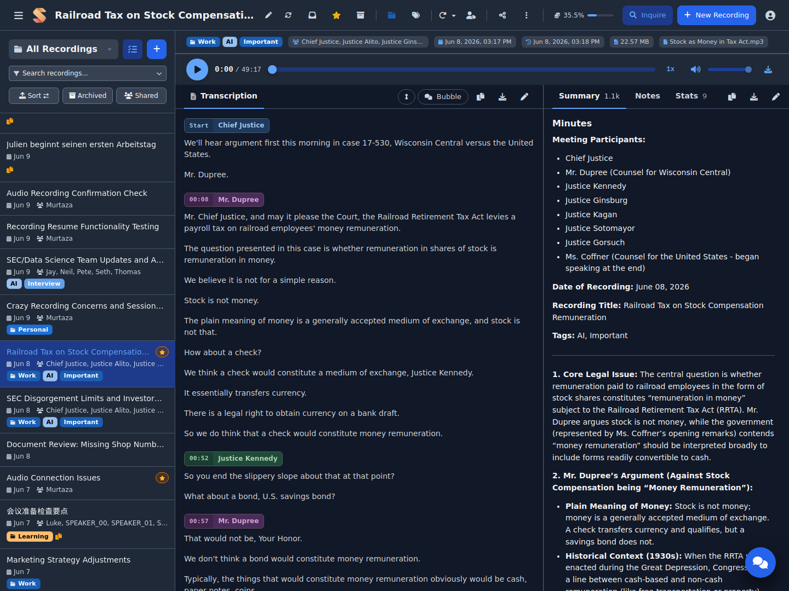
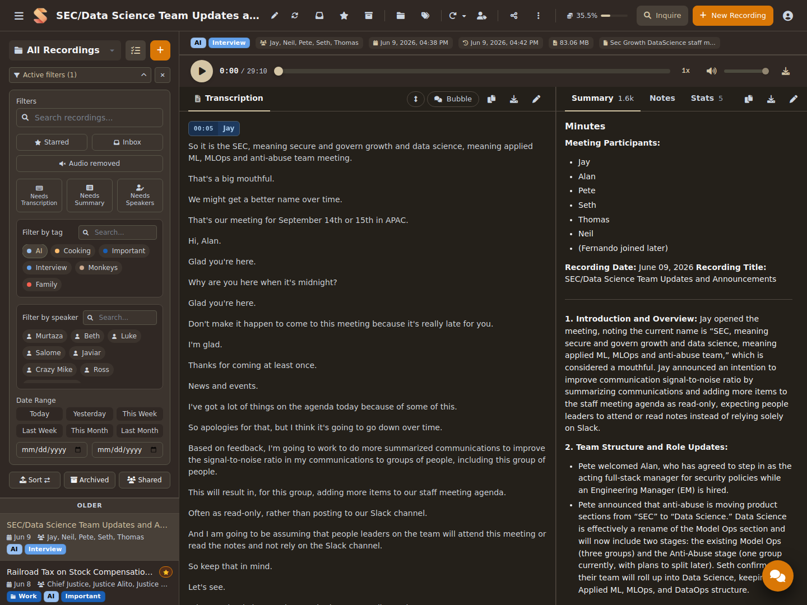
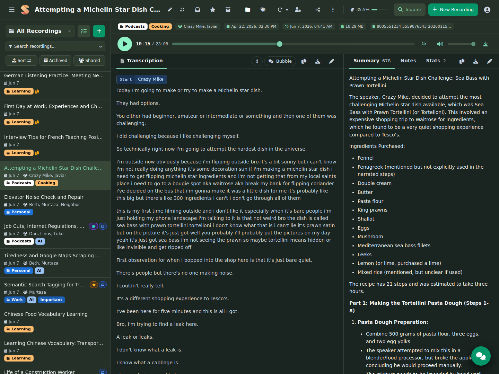
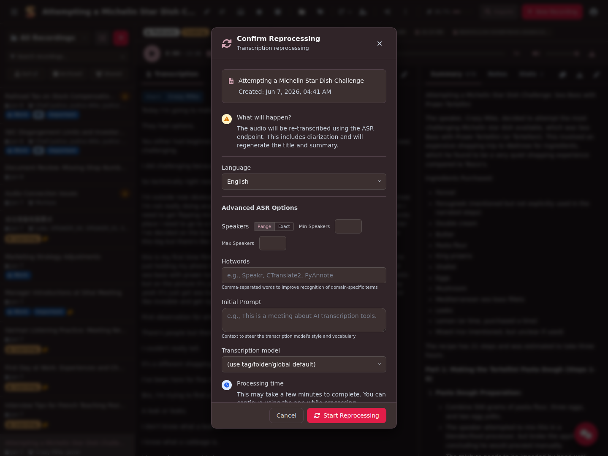
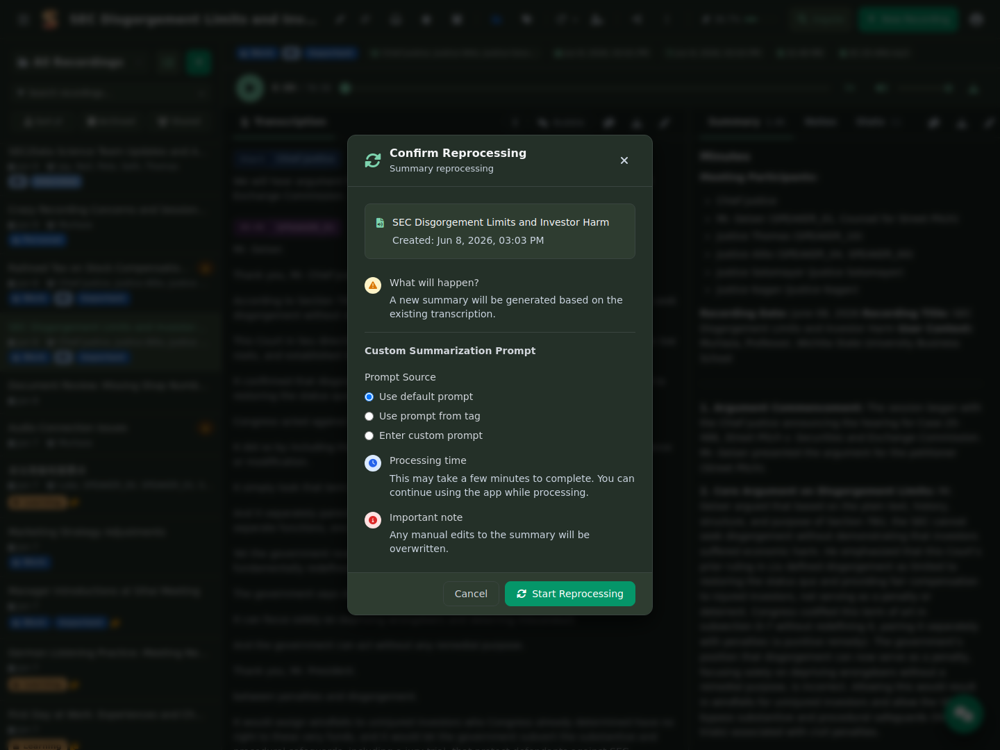

# Visão principal

A visão principal do Speakr é onde você passará a maior parte do tempo. Ela foi projetada como uma interface de três painéis que facilita navegar pelas gravações, revisar transcrições e interagir com o conteúdo. Entender cada componente ajudará você a trabalhar com mais eficiência nas suas gravações de áudio.

## Entenda o layout da interface

A visão principal é organizada em três seções distintas que trabalham juntas de forma integrada. À esquerda está a barra lateral de gravações, onde todos os arquivos de áudio são listados e podem ser filtrados. O painel central exibe a transcrição completa da gravação selecionada. Se ela tiver sido processada com ASR e diarização de locutores, você verá rótulos dos falantes e poderá clicar em qualquer frase para ir àquela posição no áudio. O painel à direita contém o resumo gerado por IA, suas anotações pessoais e uma interface de chat interativa. Acima dos painéis central e direito, ocupando toda a largura, está a barra de metadados com as informações e os botões de ação da gravação.

## Barra de navegação superior

O cabeçalho é uma única barra adaptável: na visualização de lista, mostra o logotipo do Speakr e os controles globais; ao abrir uma gravação, também passa a mostrar o título da gravação, a caneta de edição, o botão de regenerar título, o indicador de status e a linha de ícones de ação (pasta, caixa de entrada, estrela, tags, reprocessar transcrição, regenerar resumo, identificar falantes, compartilhar e excluir). À direita, o botão **Inquire** abre a pesquisa semântica em todas as gravações; o botão **+ New Recording** abre o modal de envio como uma sobreposição, mantendo a visualização de detalhes atual visível ao fundo; e seu nome de usuário aparece com um menu suspenso que contém configurações, preferências de idioma, alternância de modo escuro, seletor de esquema de cores e saída.

Em dispositivos móveis, o cabeçalho mantém apenas o título, a caneta de edição, o botão de regenerar título, a pesquisa, o + e o menu do usuário. A barra de ferramentas de ações por gravação passa para a linha expansível por seta na visualização de detalhes abaixo.

## Barra lateral esquerda — lista de gravações e filtros

A barra lateral esquerda é o centro de controle para organizar e encontrar gravações. No topo, há uma barra de pesquisa que permite localizar rapidamente gravações por título ou conteúdo. Abaixo dela, o sistema de filtros ajuda a restringir a lista de gravações.

### Use filtros

O sistema de filtros do Speakr foi projetado para ser poderoso e intuitivo. Clique em "Active filters" para expandir o painel de filtros. Você pode filtrar por tags, que aparecem como marcadores coloridos e podem ser clicadas para selecionar ou desmarcar. O filtro de intervalo de datas oferece predefinições práticas como "Today", "Yesterday", "This Week" e "Last Week"; também é possível definir um intervalo personalizado com os seletores de data. Quando há filtros ativos, a quantidade aparece ao lado do rótulo do filtro, e um botão de limpar permite redefinir todos eles de uma vez.

### Arquive gravações

Arquive uma gravação para retirá-la da lista principal sem excluir nada: clique no ícone de arquivar ao lado dos ícones de caixa de entrada e estrela, no topo de uma gravação aberta, ou selecione várias gravações e use o botão de arquivar na barra de seleção. A transcrição, o resumo, as anotações, o áudio, as tags e os compartilhamentos permanecem. A pesquisa ainda encontra gravações arquivadas, que exibem um pequeno indicador de arquivo. A opção **Archived**, abaixo da barra de pesquisa, mostra somente gravações arquivadas; nela, o mesmo ícone restaura uma gravação para a lista principal.

O arquivamento é pessoal, assim como a caixa de entrada e a estrela: arquivar uma gravação compartilhada com você a oculta apenas da sua lista.

### Lista de gravações

Abaixo dos filtros, suas gravações são exibidas como cartões que mostram, de relance, informações essenciais. Cada cartão destaca o título e exibe metadados, incluindo participantes — se foi usada diarização de locutores —, data e duração da gravação. Marcadores coloridos indicam as categorias atribuídas a cada gravação. Os pequenos ícones à direita indicam o status de processamento, usando cores diferentes para transcrições concluídas, em processamento ou com falha.

## Painel central — visualização da transcrição

O painel central é onde você lê e interage com a transcrição. Ele é o núcleo do Speakr e exibe o texto completo da gravação.

### Exibição da transcrição

A exibição da transcrição varia conforme o modo como o áudio foi processado. Se você usou um endpoint padrão da API Whisper, verá uma transcrição simples e contínua, sem identificação de falantes. O texto flui como uma única narrativa, o que funciona bem para gravações com uma pessoa ou quando a identificação de falantes não é necessária.

Se você usou um endpoint ASR com diarização de locutores ativada, as contribuições de cada pessoa serão claramente identificadas por tags coloridas, como "SPEAKER_01", "SPEAKER_02" e assim por diante. Essas tags usam cores para facilitar o acompanhamento visual de conversas com várias pessoas. Embora as marcações de tempo não apareçam no texto, clicar em qualquer frase move automaticamente o player de áudio para a posição exata, facilitando a navegação pela gravação.

### Opções de visualização

Acima da transcrição, vários botões controlam a forma como o conteúdo é exibido. O botão Copy permite copiar toda a transcrição para a área de transferência. O botão Edit ativa a edição em linha da transcrição quando você precisa fazer correções.

Se a gravação tiver sido processada com diarização de locutores, você também verá uma alternância Simple/Bubble, que muda entre uma visualização de texto contínuo e um formato de balões de conversa. Essa alternância só está disponível quando há identificação de falantes na transcrição.

## Barra de metadados da gravação

Ocupando toda a largura acima dos painéis central e direito, a barra de metadados exibe informações importantes sobre a gravação e fornece acesso rápido às ações. Da esquerda para a direita, você verá o título, os nomes dos participantes — se identificados —, a data e a hora, o tamanho do arquivo e a duração. Os botões de ação ficam no cabeçalho global ao lado do título, em grupos: caixa de entrada, estrela e arquivar; pasta e tags; um menu **Reprocess** — para transcrição, resumo e redefinição de uma gravação travada — e identificação de falantes; em seguida, compartilhar e um menu **⋯** com as opções **Delete audio, keep transcript** e **Delete recording**. Ao excluir o áudio, a transcrição, o resumo e as anotações são preservados; em uma gravação de vídeo, o arquivo de vídeo é excluído.

## Abas da coluna direita (desktop)

A coluna direita reúne três abas principais — Summary, Notes e Chat — e duas abas contextuais que aparecem quando aplicável:

- **Stats** — Uma aba de métricas por gravação, com duração total, quantidade de falantes, turnos de conversa e contagem de palavras em cartões de destaque. Em seguida, há uma tabela por falante com tempo de fala, porcentagem do áudio total, quantidade de turnos, palavras e palavras por minuto. Uma linha final de silêncio mostra quanto da gravação esteve realmente sem áudio. A aba aparece apenas quando a transcrição tem diarização de locutores com marcações de tempo por segmento.
- **Events** — Eventos de calendário extraídos da transcrição, quando houver, com exportação para ICS.

A barra de abas contém uma barra de ferramentas de ação em linha à direita — copiar, baixar e editar em Summary e Notes; exportar para o calendário em Events — para que as ações específicas de cada aba fiquem acessíveis sem sair dela.

## Painel direito — reprodução, resumo, anotações e chat

O painel direito contém três seções em abas que complementam a transcrição com recursos de IA e anotações pessoais.

### Controles de reprodução

No topo do painel direito estão os controles do player de áudio. O botão de reprodução inicia ou pausa o áudio, enquanto a linha do tempo mostra a posição atual na gravação. Clique em qualquer ponto da linha do tempo para ir até ele. O controle de velocidade permite ajustar a reprodução de 0,5x a 3x, o que é especialmente útil para revisar conteúdo rapidamente ou analisar seções específicas com cuidado.

Se a gravação tiver diarização de locutores, clicar em qualquer frase da transcrição posicionará automaticamente o player de áudio naquele momento, oferecendo uma navegação fluida pela gravação.

### Aba Summary

A aba Summary exibe uma visão geral da gravação gerada por IA. Esse resumo reúne os pontos principais, as decisões e os itens de ação, poupando tempo na revisão do conteúdo. O resumo é gerado automaticamente após o término da transcrição, mas pode ser regenerado com configurações diferentes quando necessário.

### Aba Notes

A aba Notes é seu espaço pessoal para adicionar contexto, ideias ou itens de acompanhamento relacionados à gravação. Essas anotações são privadas, podem ser pesquisadas e são ideais para registrar resultados de reuniões, lembretes pessoais ou contexto adicional que não foi capturado na gravação. As anotações aceitam formatação Markdown, permitindo criar listas, títulos e texto formatado.

### Aba Chat

A aba Chat oferece um assistente de IA interativo que pode responder perguntas sobre a gravação. Basta escrever uma pergunta como "Quais foram as principais decisões?" ou "O que João disse sobre o orçamento?"; a IA analisará a transcrição e fornecerá respostas relevantes. Isso é particularmente útil em gravações longas, quando você precisa encontrar uma informação específica com rapidez.

## Opções de reprocessamento

O Speakr fornece dois tipos de reprocessamento para atualizar gravações com configurações ou parâmetros melhores e diferentes.

### Reprocessamento completo

O reprocessamento completo transcreve novamente todo o arquivo de áudio usando o endpoint ASR. Ele é útil quando você quer alterar as configurações de diarização de locutores ou usar outro modelo de transcrição. Acesse-o clicando no ícone de atualizar na barra de metadados e selecionando "Transcription Reprocessing". Você pode ajustar a configuração de idioma, o número mínimo e máximo de falantes para diarização e outras opções específicas de ASR. Observe que o reprocessamento completo sobrescreverá edições manuais feitas na transcrição.

### Reprocessamento do resumo

O reprocessamento do resumo gera um novo título e resumo com base na transcrição existente. Ele é mais rápido que o reprocessamento completo e preserva quaisquer edições feitas no texto da transcrição. Use-o quando quiser regenerar o resumo com configurações de IA diferentes ou após fazer edições significativas na transcrição. Acesse essa opção pelo mesmo menu de atualizar, selecionando "Summary Reprocessing".

## Trabalhe com várias gravações

A visão principal foi projetada para lidar de forma eficiente com grandes bibliotecas de gravações. Você pode combinar vários filtros para encontrar exatamente o que procura. Por exemplo, pode filtrar todas as gravações com a tag "Meeting" da semana passada que mencionem "budget" na transcrição. Os filtros funcionam em conjunto e restringem os resultados a cada critério adicional.

Ao trabalhar com muitas gravações, considere usar as opções de ordenação para organizar por data de criação — quando você enviou ou gravou — ou por data da reunião — quando a gravação realmente ocorreu. Essa distinção é especialmente útil ao enviar gravações antigas ou processar uma lista acumulada de arquivos de áudio.

## Dicas de uso eficiente

Para aproveitar ao máximo a visão principal, desenvolva desde cedo uma estratégia consistente de tags. Crie tags para projetos, clientes ou tipos de reunião diferentes e aplique-as de forma consistente. Esse pequeno investimento de tempo compensa quando você precisar encontrar gravações específicas mais tarde.

A pesquisa é poderosa, mas funciona melhor com termos específicos. Em vez de procurar palavras comuns como "the" ou "meeting", pesquise termos exclusivos, nomes de projetos ou assuntos específicos discutidos nas gravações.

Use a seção de anotações imediatamente após reuniões, enquanto o contexto ainda está fresco. Essas anotações pessoais se tornam valiosas quando você revisita gravações semanas ou meses depois.

Em gravações longas, a interface de chat pode economizar muito tempo. Em vez de ler uma transcrição inteira de uma hora, faça perguntas específicas à IA sobre decisões tomadas, itens de ação atribuídos ou assuntos discutidos.

Lembre-se de que a interface é atualizada em tempo real. Quando você envia uma nova gravação ou quando a transcrição é concluída, a interface é atualizada automaticamente para mostrar o status mais recente. Você não precisa recarregar a página manualmente para ver as atualizações.

## Recursos de colaboração (opcional)

Se você trabalha com uma equipe ou família, os recursos de colaboração do Speakr ajudam a compartilhar automaticamente gravações com as pessoas certas. Esta seção aborda grupos, tags de grupo e compartilhamento: todos são opcionais, mas muito úteis quando necessários.

### Entenda grupos e tags de grupo

**Grupos** são coleções de usuários que trabalham juntos com frequência, como "Engineering Team", "Family" ou "Sales Department". Seu administrador cria e gerencia os grupos, e você se torna automaticamente membro daqueles aos quais foi adicionado.

**Tags de grupo** são tags especiais que pertencem a um grupo. Quando você aplica uma tag de grupo a uma gravação, todos os membros atuais daquele grupo recebem acesso automaticamente. Isso é ideal para conteúdo específico de projetos, reuniões de departamentos ou eventos familiares que todos devem ver.

### Use tags de grupo para compartilhar gravações

Se o administrador criou grupos e tags de grupo para você:

1. Ao criar ou editar uma gravação, clique no **ícone de tag** na barra de metadados.
2. Procure as tags que exibem um indicador de grupo; essas são suas tags de grupo.
3. Selecione qualquer tag de grupo para aplicá-la.
4. Todos os membros do grupo recebem acesso imediato a esta gravação.

As tags de grupo também podem incluir prompts de IA personalizados para resumos especializados e políticas de retenção para limpeza automática. Por exemplo, uma tag de grupo "Daily Standup" pode excluir automaticamente gravações após 14 dias, enquanto uma tag "Legal Consultations" as mantém permanentemente.

### Compartilhamento individual

Para colaborações pontuais ou compartilhamento com pessoas específicas fora dos seus grupos:

1. Abra a gravação que deseja compartilhar.
2. Clique no **ícone de compartilhar** — o ícone de usuários — na barra de ferramentas.
3. Pesquise o nome do usuário e selecione-o.
4. Escolha o nível de permissão:
    - **View Only**: pode ler e ouvir, mas não editar.
    - **Edit**: pode modificar metadados, anotações e resumo.
    - **Reshare**: pode compartilhar com outros usuários.
5. Clique para adicioná-lo; ele receberá acesso imediatamente.

### Anotações pessoais em gravações compartilhadas

Quando alguém compartilha uma gravação com você, você pode adicionar suas próprias anotações privadas, que somente você vê. Isso é ideal para acompanhar seus itens de ação ou observações pessoais sem poluir o conteúdo compartilhado. Suas anotações são totalmente separadas das anotações do proprietário da gravação e do resumo compartilhado.

Para adicionar anotações pessoais a uma gravação compartilhada, basta clicar na aba **Notes** e começar a escrever. Essas anotações são só suas e não ficam visíveis para o proprietário da gravação nem para outras pessoas que tenham acesso.

### Veja gravações compartilhadas com você

As gravações compartilhadas por outras pessoas aparecem na lista principal com um indicador visual discreto. Use o filtro **"Shared with Me"** na barra lateral para exibir somente as gravações compartilhadas com você e se concentrar no conteúdo colaborativo.

Para obter todos os detalhes sobre os recursos de colaboração, consulte o [guia de compartilhamento e colaboração](sharing.md).

## Crie novo conteúdo

Agora que você sabe navegar e interagir com gravações existentes na visão principal, vamos explorar como criar conteúdo. O Speakr oferece duas formas de adicionar gravações à biblioteca: enviando arquivos de áudio existentes ou gravando diretamente no navegador.

---

Próximo: [Gravação e envio de áudio](recording.md) →
