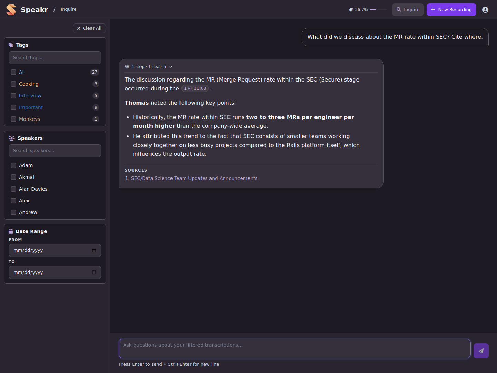

# Modo Inquire — pesquisa semântica

O Modo Inquire transforma toda a sua biblioteca de gravações em uma base de conhecimento inteligente, que você pode pesquisar com perguntas em linguagem natural. Em vez de procurar em gravações individuais ou tentar lembrar qual reunião continha uma discussão específica, basta fazer perguntas e receber respostas abrangentes extraídas de todas as gravações relevantes.

## Entenda o Modo Inquire

Pense no Modo Inquire como um assistente experiente que ouviu todas as gravações da sua biblioteca e pode recordar e sintetizar imediatamente informações de qualquer uma delas. Quando você faz uma pergunta, o sistema pesquisa todas as transcrições, entende o contexto e o significado da consulta e fornece uma resposta coerente, com citações que apontam para as gravações de origem.

Esse recurso de pesquisa semântica vai muito além da simples correspondência de palavras-chave. O sistema entende conceitos, relações e contexto. Se você perguntar sobre "preocupações com o orçamento", ele encontrará discussões sobre restrições financeiras, estouros de custo, problemas de financiamento e limitações de recursos, mesmo que a expressão exata nunca tenha sido mencionada.

## Comece a usar o Modo Inquire

Abra o Modo Inquire clicando no botão Inquire da barra de navegação superior. A interface é aberta com uma área de pesquisa limpa no topo e opções avançadas de filtro à esquerda. Os resultados aparecem na área principal do conteúdo, organizados e formatados para facilitar a leitura.

A beleza do Modo Inquire é sua simplicidade. Você não precisa aprender sintaxe ou comandos especiais de pesquisa. Digite a pergunta como faria a um colega, e o sistema cuida da complexidade de encontrar e sintetizar as informações relevantes.

!!! tip "+ New Recording no Modo Inquire"
    O Modo Inquire é executado como um aplicativo Vue separado e, por isso, não pode incorporar diretamente o modal de envio do aplicativo principal. O botão **+ New Recording** no cabeçalho do Inquire redireciona para `/?upload=1`; ao iniciar, o aplicativo principal lê esse parâmetro de consulta, abre automaticamente o modal de envio e remove o parâmetro da URL para que uma atualização não o dispare novamente. Resultado: basta um clique para sair de "preciso adicionar uma gravação" e chegar ao modal de envio, como ao pressionar + New Recording em qualquer outra área do aplicativo.

## Use filtros para focar sua pesquisa

A barra lateral esquerda contém filtros que ajudam a limitar a pesquisa a gravações específicas antes de você fazer a pergunta. Isso é particularmente útil em bibliotecas grandes, quando você quer concentrar-se em certos contextos.

O filtro de tags permite selecionar gravações com tags específicas, o que é ideal para pesquisar dentro de determinado projeto, cliente ou tipo de reunião. Se você etiquetar as gravações de forma consistente, isso se torna uma maneira eficaz de segmentar as pesquisas. O sistema mostra quantas gravações correspondem a cada tag, ajudando a entender o escopo da pesquisa.

O filtro de falantes permite concentrar-se no que pessoas específicas disseram nas gravações. Isso é valioso quando você precisa acompanhar compromissos de determinada pessoa, entender a perspectiva de alguém sobre vários assuntos ou preparar-se para uma reunião com indivíduos específicos.

O filtro de intervalo de datas ajuda a concentrar-se em discussões recentes ou pesquisar dentro de um período específico. Ele é particularmente útil para acompanhar como as discussões evoluíram ao longo do tempo ou encontrar informações de determinado trimestre ou fase de projeto.

## Faça perguntas eficazes

A chave para obter ótimos resultados no Modo Inquire é formular perguntas claras e específicas. O sistema funciona melhor quando você fornece contexto e deixa claro o que procura.

Em vez de pesquisar apenas palavras como "prazo", faça perguntas completas como "Quais são os próximos prazos para o projeto do aplicativo móvel?". Isso ajuda a IA a entender não apenas qual informação você quer, mas por que a quer e como apresentá-la da forma mais útil.

O sistema se destaca em tipos diferentes de consulta. Você pode pedir resumos de tópicos específicos em várias reuniões, solicitar listas de itens de ação ou decisões, pesquisar declarações ou compromissos específicos, analisar padrões ou tendências nas discussões e identificar problemas e soluções propostas.

## Entenda os resultados

Quando o Modo Inquire retorna resultados, ele fornece uma resposta sintetizada, baseada em todas as gravações relevantes. A resposta não é apenas uma lista de ocorrências: é uma narrativa coerente que combina informações de várias fontes em uma resposta unificada.

Cada informação inclui uma citação no formato `(Recording ID: XX)`, vinculada diretamente à gravação de origem. Clicar nesses links leva à gravação completa, na qual você pode ver todo o contexto. Essa transparência permite sempre verificar a informação e aprofundar-se quando necessário.

O sistema organiza as informações de forma inteligente, agrupando pontos relacionados e apresentando-os num fluxo lógico. Se várias gravações discutirem o mesmo assunto, a resposta sintetizará essas conversas e mostrará como elas evoluíram ao longo do tempo, mantendo uma atribuição clara a cada fonte.

## Aplicações práticas

O Modo Inquire se destaca em muitos cenários reais. Ao preparar reuniões, você pode revisar rapidamente o que já foi discutido sobre os itens da pauta, quais questões ficaram sem solução e quais compromissos foram assumidos. Assim, você entra em reuniões bem informado, sem gastar horas revisando gravações antigas.

Para gerenciamento de projetos, o sistema ajuda a acompanhar decisões em várias reuniões, identificar todos os itens de ação atribuídos a membros do grupo e monitorar como requisitos ou prioridades do projeto mudaram ao longo do tempo. Você pode perguntar, por exemplo, "Quais riscos foram identificados para o lançamento do produto?" e receber uma lista abrangente baseada em todas as discussões relevantes.

Pesquisa e análise tornam-se muito mais eficientes. Seja analisando padrões de feedback de clientes, acompanhando menções a concorrentes ou identificando temas recorrentes em entrevistas, o Modo Inquire pode revelar informações que permaneceriam ocultas em horas de gravação.

O sistema também é uma excelente ferramenta de conformidade e documentação. Você pode encontrar rapidamente compromissos específicos assumidos com clientes, localizar discussões sobre requisitos regulatórios ou verificar o que foi acordado em negociações. O sistema de citações cria uma trilha de auditoria até as gravações originais.

## Estratégias avançadas de pesquisa

À medida que se familiarizar com o Modo Inquire, você poderá desenvolver estratégias mais sofisticadas. Comece com perguntas abrangentes para compreender o panorama das informações disponíveis; depois, aprofunde-se com consultas cada vez mais específicas. Essa abordagem iterativa ajuda a descobrir informações que você talvez não soubesse procurar diretamente.

Combine filtros de modo estratégico. Por exemplo, ao preparar uma reunião com cliente, filtre pela tag desse cliente e pelo intervalo de datas relevante; então, pergunte sobre questões ou compromissos pendentes. Essa abordagem focada produz resultados muito relevantes, sem o ruído de gravações não relacionadas.

Observe como o sistema interpreta as perguntas. Se os resultados não forem o que esperava, tente reformulá-las com termos diferentes ou mais contexto. O sistema aprende com os padrões das gravações; portanto, usar terminologia consistente com suas discussões reais costuma produzir resultados melhores.

## Considerações técnicas

O poder do Modo Inquire vem da capacidade de compreensão semântica. Quando embeddings estão ativados, com `sentence-transformers` instalado, o sistema cria representações matemáticas de significado que permitem entender conceitos além da correspondência simples de palavras-chave. Assim, ele encontra informações relevantes mesmo quando palavras diferentes expressam as mesmas ideias.

O Speakr usa por padrão o modelo de embeddings all-MiniLM-L6-v2, uma escolha deliberadamente leve que equilibra desempenho e eficiência de recursos. O modelo gera vetores de 384 dimensões e funciona confortavelmente em sistemas somente com CPU, algo essencial porque a maioria das implantações do Speakr ocorre em servidores comuns ou máquinas pessoais sem GPUs dedicadas. O padrão fornece boa compreensão semântica para conteúdo conversacional e continua responsivo mesmo ao processar centenas de gravações. Administradores que preferirem outro equilíbrio podem substituir o modelo pela variável de ambiente `EMBEDDING_MODEL` ou transferir totalmente a geração de embeddings a um provedor de API compatível com OpenAI — vLLM, OpenRouter, OpenAI e similares — configurando `EMBEDDING_BASE_URL`. Veja [Configuração de modelos](../admin-guide/model-configuration.md#configurable-embedding-model) para mais detalhes.

O sistema processa as gravações em partes, permitindo pesquisar até gravações muito longas com eficiência. Transcrições com diarização são divididas respeitando os segmentos: cada parte contém turnos completos de fala, renderizados como linhas `Speaker: text`, agrupados em aproximadamente 1.400 caracteres e com sobreposição de um turno entre partes consecutivas. Como os limites se baseiam no tamanho, e não por turno, uma troca rápida entre pessoas permanece junta numa única parte, com cada falante identificado na linha. Cada parte também armazena seu falante predominante e carimbos de data e hora inicial e final; isso permite que resultados e citações do Inquire apontem para o momento em que algo foi dito. Administradores podem manter o comportamento antigo, de janelas simples por caracteres, com `CHUNKING_STRATEGY=legacy`. Em ambos os casos, partes já indexadas não são alteradas por uma atualização até que a gravação seja reindexada. O tamanho das partes é ajustável por `CHUNK_TARGET_CHARS`.

Uma observação sobre trocar modelos de embeddings: vetores de modelos diferentes não são comparáveis, mesmo quando têm a mesma dimensão. Depois de alterar `EMBEDDING_MODEL` ou `EMBEDDING_BASE_URL` para outro modelo, gere novamente os embeddings da biblioteca — pelas ferramentas de reprocessamento do painel administrativo ou reindexando gravações individualmente — para que a qualidade da pesquisa não se degrade silenciosamente.

O desempenho escala bem com uma configuração adequada. A indexação inicial acontece automaticamente após a transcrição, e as pesquisas seguintes usam esse índice pré-calculado. Os tempos de resposta normalmente variam de alguns segundos para pesquisas focadas a um pouco mais para consultas complexas em bibliotecas grandes.

## Pesquise a partir de outras ferramentas

A pesquisa semântica também está disponível pela API: `GET /api/v1/search?mode=semantic`; consulte a [referência da API](api-reference.md#search). A mesma solicitação sem `mode=semantic` executa uma pesquisa por palavras-chave em todas as gravações, sem precisar do Modo Inquire.

## Inquire agêntico, beta

Administradores podem ativar o modo agêntico com `ENABLE_INQUIRE_AGENT=true`, o que requer o Modo Inquire ativado. Em vez de uma única etapa de recuperação, um agente de IA trabalha iterativamente: pesquisa transcrições, lista gravações e lê transcrições, resumos ou anotações conforme necessário, raciocinando entre etapas até responder. A interface mostra cada etapa ao vivo — o que foi pesquisado, o que foi lido e quantas correspondências houve —, tem um botão Stop para interromper e inclui uma linha de atividade recolhida em cada resposta, para que você sempre saiba como uma conclusão foi alcançada. As respostas citam fontes com marcadores numéricos compactos, como "2 @ 14:05". Clicar em um abre a gravação e inicia a reprodução no momento citado; uma lista Sources no fim da resposta relaciona cada número à sua gravação. A numeração permanece estável na conversa, então uma pergunta complementar como "fale mais sobre 3" se refere exatamente ao que você viu.

Alguns exemplos mostram a diferença em relação ao Inquire clássico. Pergunte "o que decidimos sobre a alteração de preços, e alguém discordou?" e o agente pesquisará as discussões de preços, lerá as seções relevantes das transcrições de várias reuniões e responderá com cada posição citada no ponto onde foi expressa. Pergunte "resuma tudo o que o cliente X pediu neste trimestre" e ele listará as gravações envolvendo o cliente, lerá seus resumos e consolidará os pedidos com uma citação para cada item. Pergunte "quando mencionei pela primeira vez o plano de migração?" e ele pesquisará, comparará as datas e fornecerá um link que inicia a reprodução naquela frase. O Inquire clássico recupera passagens numa única etapa e responde a partir do que essa busca encontrou; o agente continua trabalhando até a pergunta ser realmente respondida. Essa é a diferença percebida em perguntas que abrangem várias gravações ou exigem verificar um fato, em vez de apenas parafrasear.

O agente respeita as configurações de privacidade. Em Account, a seção Inquire Privacy controla o que ele pode ler: transcrições estão sempre disponíveis, pois são o mínimo para o Inquire funcionar; resumos são opcionais e ficam ativados por padrão; e suas anotações são opcionais e ficam desativadas por padrão. Um tipo de conteúdo desativado é removido completamente das ferramentas do agente. Só suas próprias anotações são usadas, nunca anotações de gravações compartilhadas com você. A seleção de filtros ativa é um limite rígido: o agente pode restringir a pesquisa dentro dos filtros, mas nunca alcançar gravações fora deles.

Conversas longas são tratadas automaticamente. Quando a conversa ultrapassa o limite de contexto, os turnos antigos são condensados num resumo que o assistente mantém. Um divisor aparece no chat onde isso ocorreu; ao clicar nele, você vê exatamente o que o assistente ainda lembra. Um pequeno medidor próximo à entrada mostra o quanto do contexto está ocupado quando ele passa da metade.

Respostas agênticas envolvem várias chamadas de modelo por pergunta; por isso, levam mais tempo, normalmente de 10 a 30 segundos em perguntas de várias etapas, e consomem mais tokens que o pipeline clássico. O uso é acompanhado separadamente no painel administrativo, sob o tipo de operação `inquire_agent`. O agente funciona com qualquer endpoint compatível com OpenAI: usa chamada nativa de ferramentas quando o endpoint oferece suporte e recorre a um protocolo via prompt quando não oferece. Se o agente falhar por qualquer motivo, o pipeline clássico de uma única etapa responderá em seu lugar. Consulte `config/env.transcription.example` para as variáveis de ajuste — limites de etapas, tempos limite, orçamento de contexto e padrões de disponibilidade.

## Aproveite ao máximo o Modo Inquire

Para maximizar o valor do Modo Inquire, mantenha bons hábitos de gravação. Garanta áudio claro para obter transcrições precisas, use identificação de falantes para acompanhar quem disse o quê e aplique tags consistentes para organizar o conteúdo. Quanto melhores os dados de entrada, mais poderosas se tornam as pesquisas.

Aproveite a natureza iterativa da pesquisa. Comece com uma pergunta geral, revise os resultados e faça perguntas de acompanhamento para aprofundar-se. O sistema preserva o contexto dentro de uma sessão, facilitando refinar a pesquisa a partir dos resultados iniciais.

Lembre-se de que o Modo Inquire complementa, e não substitui, a interface padrão de gravações. Use-o para descoberta e síntese em várias gravações, mas, quando precisar de foco profundo numa única gravação, a visualização padrão da transcrição com sua interface de chat pode ser mais apropriada.

## Limitações importantes

Embora seja poderoso, o Modo Inquire tem limites. Ele pesquisa apenas o texto transcrito, não o áudio diretamente; portanto, erros de transcrição afetarão os resultados. O sistema não pode inferir informações que não foram declaradas explicitamente nas gravações: ele encontra e sintetiza o que foi dito, não o que se quis dizer, mas ficou implícito.

O suporte a idiomas depende do modelo de embeddings configurado. O all-MiniLM-L6-v2 padrão foi treinado principalmente em inglês; portanto, conteúdo em outros idiomas apresenta resultados variados. Trocar para um modelo multilíngue, como `paraphrase-multilingual-MiniLM-L12-v2`, ou para um modelo grande de API, como `openai/text-embedding-3-large`, melhora significativamente a qualidade entre idiomas. Gravações muito longas podem ser resumidas, em vez de totalmente indexadas, se ultrapassarem os limites de processamento. O sistema exige que as gravações estejam totalmente processadas antes de poder pesquisá-las; por isso, gravações muito recentes podem não aparecer imediatamente nos resultados.

---

Próximo: [Compartilhe gravações](sharing.md) →
