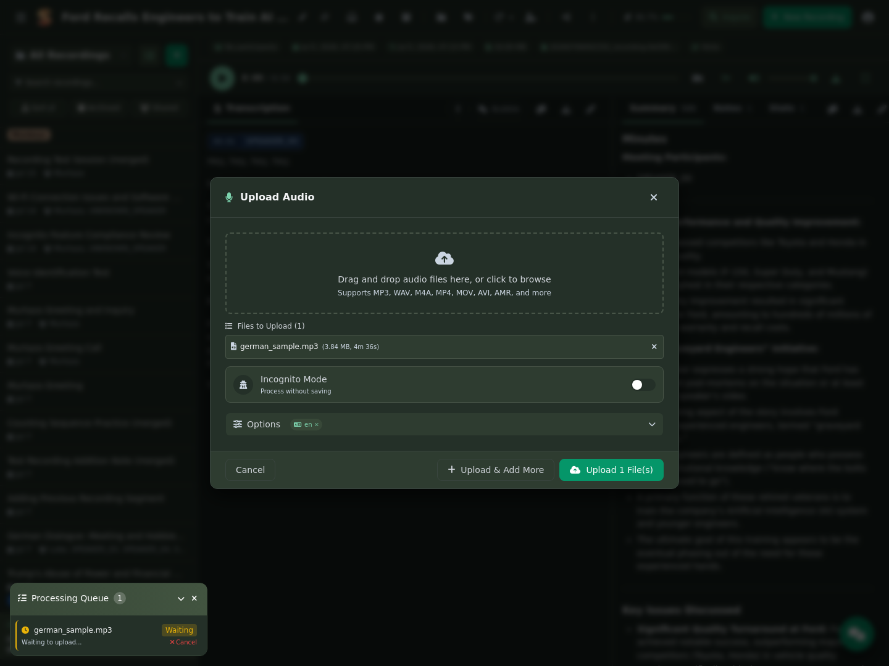
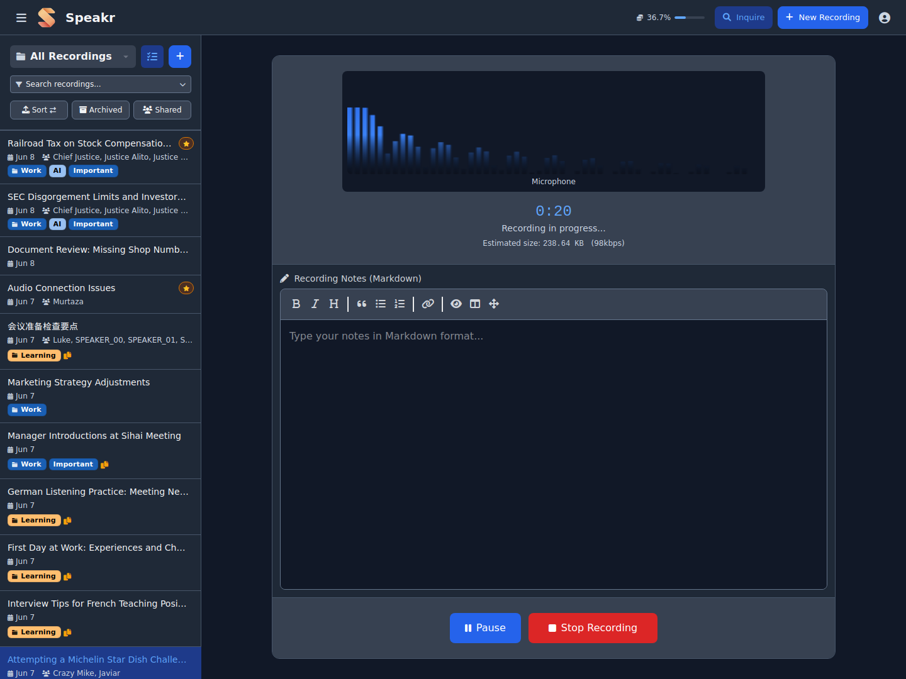
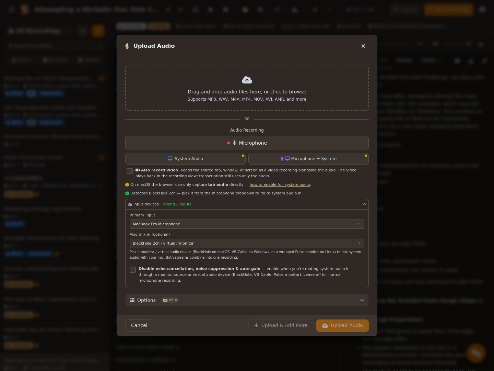
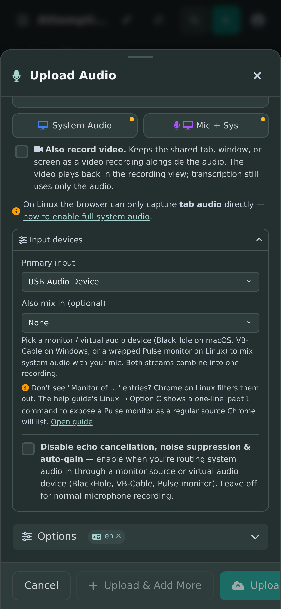
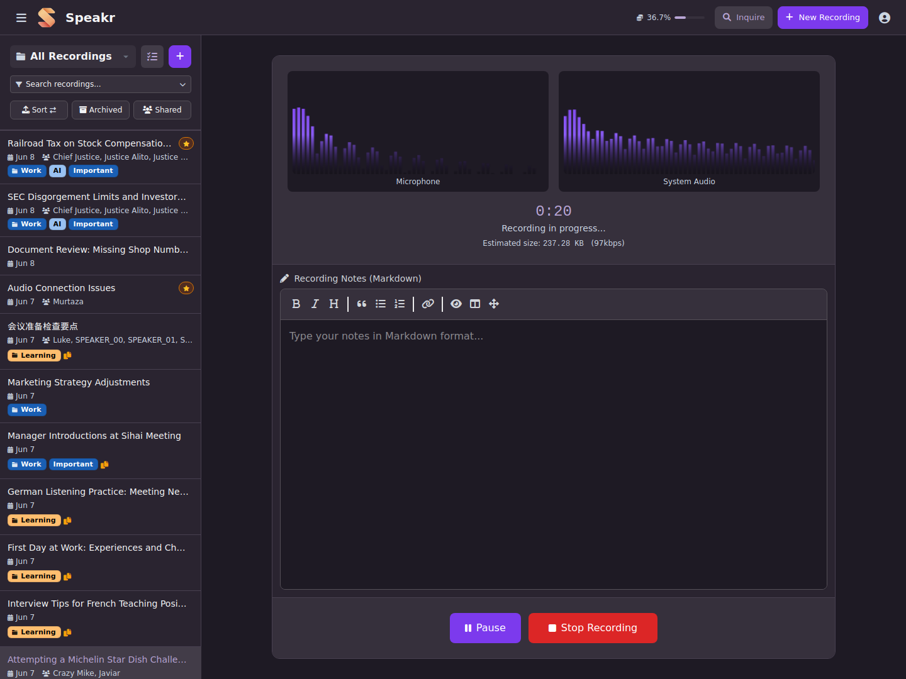
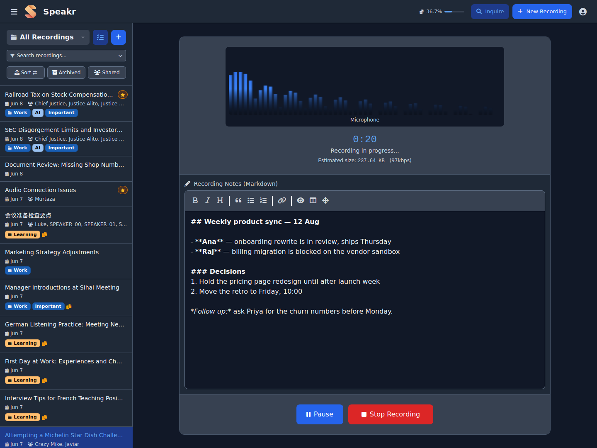
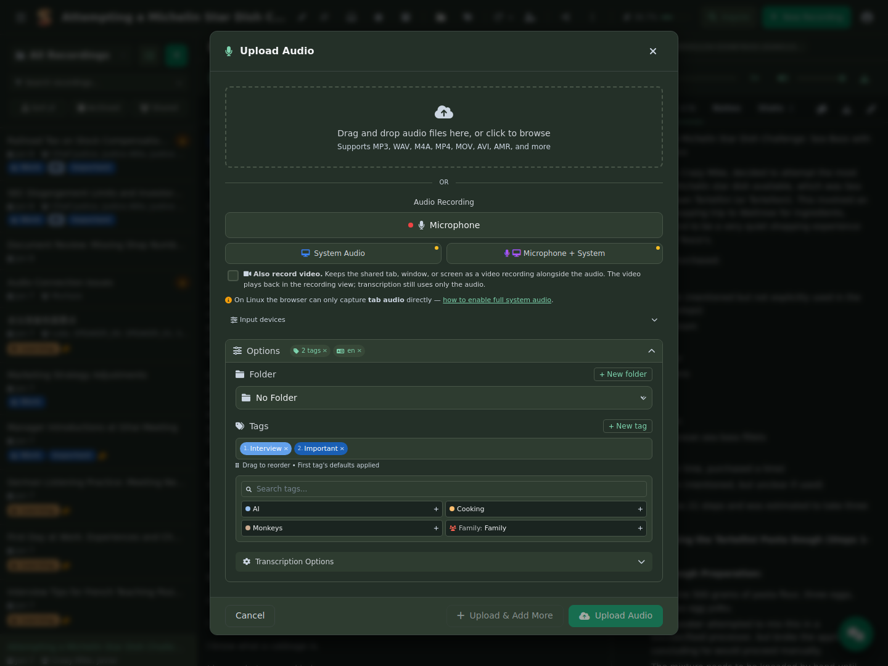

# Gravação e envio de áudio

O Speakr oferece duas formas eficientes de adicionar conteúdo à sua biblioteca: enviar arquivos de áudio existentes para transcrição ou gravar um novo áudio diretamente no navegador. Os dois métodos incluem os mesmos recursos avançados de organização, [tags](settings.md#tag-management-tab) e processamento. Depois de gravar, você pode [trabalhar com as transcrições](transcripts.md) e usar os [recursos de IA](../features.md#ai-powered-intelligence).

## Importante: requisitos do navegador para gravação

Os recursos de segurança do navegador afetam a capacidade de gravar áudio, especialmente o áudio do sistema. A maioria dos navegadores exige HTTPS para capturar áudio; `localhost` é uma exceção permitida. Se você acessa o Speakr por HTTP a partir de outra máquina na rede, talvez seja necessário configurar o navegador para permitir a gravação de áudio em conexões não seguras. As instruções estão no fim desta página.

Ao gravar áudio do sistema, você concederá permissão de compartilhamento de tela e marcará a caixa **"Share system audio"** ou **"Share tab audio"** no diálogo de compartilhamento. A redação varia um pouco entre navegadores, mas a opção está disponível para os modos de captura compatíveis com sua plataforma. Consulte a [matriz de suporte por plataforma](#platform-support-matrix) para saber quais modos funcionam em cada combinação de sistema operacional e navegador.

## Acesse o modal de envio

Clique no botão **+ New Recording** na barra de navegação superior, no cartão da tela vazia ou no link direto do modo Inquire. Isso abre o modal de envio sobre a lista de gravações ou sobre a visualização de detalhes da gravação aberta. Clicar no plano de fundo ou pressionar Esc fecha o modal sem enviar nada.



## Envie arquivos de áudio

A interface de envio oferece uma área simples de arrastar e soltar no topo da tela. Arraste arquivos de áudio diretamente do gerenciador de arquivos para essa área ou clique nela para abrir o seletor de arquivos e escolhê-los.

O Speakr é compatível com uma [ampla variedade de formatos de áudio e vídeo](../faq.md#what-audio-formats-does-speakr-support). Formatos comuns de áudio, como MP3, WAV, M4A, FLAC, AAC e OGG, funcionam normalmente. Você também pode enviar vídeos, incluindo MP4, MOV e AVI; o Speakr extrairá e processará a faixa de áudio. Gravações de dispositivos móveis nos formatos AMR, 3GP e 3GPP também são compatíveis. O limite padrão é de 500 MB, mas o administrador pode alterá-lo nas [configurações do sistema](../admin-guide/system-settings.md#maximum-file-size). Para arquivos com mais de 25 MB enviados à OpenAI, consulte a [configuração de divisão em partes](../troubleshooting.md#files-over-25mb-fail-with-openai).

!!! info "Compactação automática de áudio"
    O Speakr compacta automaticamente envios sem perdas — WAV e AIFF — para economizar espaço de armazenamento. Após a compactação, um arquivo WAV de 500 MB normalmente passa a ocupar cerca de 50 MB. Isso acontece de forma transparente durante o envio; não é necessário converter os arquivos antes. Formatos já compactados, como MP3, são mantidos como estão. Veja as [configurações de compactação de áudio](../admin-guide/system-settings.md#audio-compression) para conhecer as opções disponíveis.

Quando você envia um arquivo, ele aparece imediatamente na fila de envio, com uma barra de progresso que mostra seu status. Depois do envio, você pode adicionar [tags](settings.md#tag-management-tab), definir um título personalizado e configurar as opções de processamento antes de iniciar a transcrição. As tags podem incluir [prompts de IA personalizados](../admin-guide/prompts.md) para processamento especializado.

## Grave áudio ao vivo

O modal de envio contém três botões de gravação abaixo da área de arrastar e soltar arquivos. **Microphone** é o botão principal, em largura total, para o caso de uso comum. **System Audio** e **Mic + System** aparecem em uma segunda linha, como botões menores com ícones coloridos. Um pequeno ponto âmbar aparece nos botões System Audio e Mic + System quando o Speakr detecta que o áudio completo do sistema provavelmente não funcionará na plataforma. Nesse caso, clicar no botão ainda funciona para áudio de abas do navegador, e um link no modal de ajuda explica a alternativa. Consulte a [matriz de plataformas](#platform-support-matrix) abaixo.



### Gravação pelo microfone

Captura o áudio do microfone selecionado. É ideal para reuniões presenciais, anotações de voz pessoais e entrevistas. O navegador pedirá permissão de microfone na primeira vez. Por padrão, o Speakr usa a entrada padrão do sistema operacional. Se quiser usar um headset USB, dispositivo de áudio virtual ou uma fonte monitorada do Pulse, escolha um dispositivo específico no seletor **Input devices**, descrito abaixo.

### Gravação do áudio do sistema

Captura o áudio reproduzido pelo computador — ou por uma aba específica — usando a API de compartilhamento de tela do navegador. É ideal para gravar reuniões on-line quando você está principalmente ouvindo, webinars, apresentações on-line, podcasts ou qualquer áudio reproduzido localmente. Ao clicar no botão, o navegador mostra o diálogo de compartilhamento. Escolha **Entire Screen**, uma **Window** ou uma **Tab** e marque **Share system audio** ou **Share tab audio**. Essa caixa é essencial: sem ela, a gravação ficará silenciosa.

### Gravação combinada: microfone e sistema

Grava simultaneamente o microfone e o áudio do sistema, misturando-os em uma única faixa sincronizada. É o modo recomendado para reuniões on-line nas quais você participa ativamente, pois captura ambos os lados da conversa. Ele usa o mesmo diálogo de compartilhamento da gravação de áudio do sistema, com a mesma exigência de marcar **Share system audio**.

### Grave também o vídeo (opcional)

Quando o servidor tem retenção de vídeo ativada (`VIDEO_RETENTION=true`), os dois modos de captura de tela exibem a opção **Also record video** abaixo dos botões de gravação. Ao marcá-la, o Speakr mantém a aba, janela ou tela compartilhada como uma gravação de vídeo junto do áudio. Isso é útil para capturar compartilhamentos de tela em reuniões sem usar um gravador de tela separado.

- Durante a gravação, a visualização mostra uma prévia ao vivo da superfície capturada. A gravação concluída é reproduzida pelo player de vídeo acoplado, o mesmo usado para arquivos de vídeo enviados.
- A transcrição sempre usa apenas a faixa de áudio; o vídeo não altera transcrições, resumos nem o chat.
- A captura de vídeo segue as mesmas regras de plataforma do áudio do sistema: será gravada a superfície que o navegador permitir compartilhar — e da qual conseguir fornecer áudio. Essa escolha persiste entre sessões.
- O vídeo da tela é capturado com uma taxa de bits limitada a 2.500 kbps por padrão, configurável pelo administrador com `RECORDING_VIDEO_KBPS`. Uma hora de captura ocupa aproximadamente 1 GB. Para gravações longas, o ideal é ativar as [sessões de gravação no servidor](../admin-guide/recording-sessions.md).

## Matriz de suporte por plataforma

A API `getDisplayMedia` do navegador determina quais modos de captura de áudio do sistema realmente funcionam. O Speakr detecta o sistema operacional e o navegador e mostra dicas adequadas à plataforma na própria interface; o resumo está abaixo:

| Navegador | Sistema operacional | Áudio da aba | Áudio da janela | Áudio completo do sistema |
|---|---|---|---|---|
| Chrome / Edge | Windows / ChromeOS | ✅ | ✅ | ✅ pela caixa "Share system audio" |
| Chrome / Edge | macOS | ✅, apenas ao compartilhar uma aba | ❌ | ❌ — requer dispositivo de áudio virtual |
| Chrome / Edge | Linux | ✅, apenas ao compartilhar uma aba | ❌ | ❌ — requer uma fonte monitorada do Pulse |
| Firefox | qualquer sistema operacional | ❌ | ❌ | ❌ — sem áudio por `getDisplayMedia` |
| Safari | qualquer sistema operacional | ❌ | ❌ | ❌ — sem áudio por `getDisplayMedia` |

Se você clicar em System Audio ou Mic + System numa plataforma em que a captura não fornece uma faixa de áudio, o Speakr abre automaticamente um guia de ajuda para o sistema operacional. As abas desse guia são descritas a seguir.

## Configuração de áudio do sistema por sistema operacional

### macOS

O macOS não permite que navegadores capturem áudio do sistema diretamente. O sistema operacional trata a captura como uma operação privilegiada, que navegadores — aplicativos em sandbox — não podem solicitar. Há dois caminhos:

**Opção A: áudio da aba, sem instalação.** Reproduza o conteúdo de origem em uma aba do Chrome — YouTube, Zoom na web, URL da reunião etc. —, clique em **System Audio** no Speakr, escolha essa aba no diálogo de compartilhamento e marque **Share tab audio**. Funciona apenas para conteúdo reproduzido dentro de uma aba; o áudio de aplicativos nativos, como Slack Desktop e cliente nativo do Zoom, não será capturado.

**Opção B: dispositivo de áudio virtual, recomendado para áudio de aplicativos nativos.** Instale o [BlackHole 2ch](https://existential.audio/blackhole/), gratuito e com instalador assinado sem solicitações de extensão de kernel. Abra **Audio MIDI Setup**, crie um **Multi-Output Device** com seus alto-falantes e o BlackHole e defina-o como a saída do sistema. No Speakr, clique em **Microphone** e escolha **BlackHole 2ch** como entrada. Depois de configurado, o áudio do sistema será capturado continuamente, independentemente da aba ou janela ativa. Uma alternativa comercial é o [Loopback](https://rogueamoeba.com/loopback/), da Rogue Amoeba, com experiência de uso mais refinada.

### Windows

Chrome e Edge no Windows oferecem o caminho mais simples: a captura de todo o sistema funciona imediatamente.

1. Clique em **System Audio** ou **Mic + System** no Speakr.
2. Escolha **Entire Screen** no diálogo de compartilhamento.
3. Marque **Share system audio**, no canto inferior esquerdo do diálogo.
4. Clique em **Share**.

Também há captura por janela: escolha **Window** em vez de Entire Screen, selecione o aplicativo específico e marque **Share window audio**. É útil para gravar reuniões sem captar o ruído do seu teclado ou de digitação.

Se ocorrerem erros de "no audio track" com aplicativos específicos — o Spotify Desktop e vídeos protegidos por DRM às vezes impedem a captura de áudio do sistema —, a solução habitual é usar um cabo virtual como o [VB-Audio Cable](https://vb-audio.com/Cable/).

### Linux

No Linux há três caminhos distintos. Escolha o que corresponde ao áudio que você quer capturar:

**Opção A: áudio da aba, sem configuração.** Reproduza o conteúdo de origem numa aba do Chrome, clique em **System Audio**, escolha a aba no diálogo de compartilhamento e marque **Share tab audio**. Observação: isso não aparece no pavucontrol. O Chrome captura o áudio da aba internamente e nunca o encaminha pelo PulseAudio; por isso, a aba Recording informará "No application is currently recording audio." Isso é normal: o medidor do Speakr é a fonte de verdade. Apenas o áudio reproduzido dentro de uma aba será capturado; aplicativos nativos como Slack, Spotify Desktop e Discord não serão incluídos.

**Opção B: altere a fonte no pavucontrol durante a gravação.** É uma alternativa rápida, mas limitada: captura o áudio do sistema em vez da entrada do microfone. Só é útil quando você quer gravar o que está tocando nos fones ou alto-falantes sem sua própria voz. Clique em **Microphone** no Speakr, abra `pavucontrol` → aba **Recording** e altere a fonte de captura do Speakr do microfone para **Monitor of &lt;your output&gt;**.

**Opção C: exponha uma fonte virtual para que o Chrome a liste, recomendada.** No Linux, o Chrome filtra deliberadamente as fontes "Monitor of …" da lista de dispositivos de entrada que expõe a aplicativos web. Por isso, elas não aparecem no seletor do Speakr, embora estejam no pavucontrol. A solução é encapsular uma fonte monitorada em uma fonte virtual comum que o Chrome não filtre. Depois disso, a nova fonte aparece no seletor do Speakr e pode ser usada como entrada principal ou como **Also mix in** ao lado do microfone real.

Encontre o nome da saída — a parte anterior a `.monitor`:

```bash
pactl list short sinks
```

Em seguida, encapsule o monitor como uma fonte virtual que o Chrome exibirá:

```bash
pactl load-module module-virtual-source \
    source_name=speakr_loopback \
    master=<sink_name>.monitor
```

Atualize o seletor de dispositivos de entrada do Speakr. Agora `speakr_loopback` aparecerá no menu. Escolha-o como **"Also mix in"** junto com seu microfone real para capturar os dois. Para manter a configuração após reinicializações, adicione a linha `load-module`, sem `pactl`, a `~/.config/pulse/default.pa`.

**PipeWire, distribuições mais recentes.** A ideia é a mesma: encapsular o monitor em uma fonte virtual para que o Chrome não o filtre. Use `pw-loopback`:

```bash
pw-loopback \
  --capture-props='node.target=<sink>.monitor' \
  --playback-props='media.class=Audio/Source node.name=speakr_loopback'
```

Ou use `qpwgraph` ou `helvum` para conectar os componentes visualmente.

## Seletor de dispositivo de entrada e gravação de múltiplas entradas

Abaixo dos botões de gravação há uma seção recolhível chamada **Input devices**. Ao expandi-la, aparecem dois menus:



- **Primary input** — usa por padrão o microfone padrão do sistema operacional. Escolha uma entrada específica se quiser usar headset USB, receptor sem fio, interface de áudio, BlackHole, VB-Cable ou uma fonte monitorada do Pulse ou PipeWire como dispositivo de captura principal. Entradas virtuais ou monitoradas recebem um indicador. A seleção principal é usada tanto nas gravações **Microphone** quanto **Mic + System**.
- **Also mix in, opcional** — escolha um segundo dispositivo de entrada. O Speakr captura os dois fluxos em paralelo e os mistura via Web Audio em uma faixa MediaRecorder. Essa é a solução padrão para **capturar ambos os lados de uma reunião** no macOS ou Linux, em que o navegador não captura todo o áudio do sistema nativamente: defina o microfone real como Primary, BlackHole, `speakr_loopback` ou VB-Cable como secundário, e uma gravação capturará sua voz e os participantes remotos.

Abrir **New Recording** não solicita permissão de microfone. Normalmente, os nomes dos dispositivos ficam em branco até que a permissão seja concedida. Você pode expandir o seletor e clicar em **Request microphone permission** ou simplesmente pressionar **Microphone** e responder à solicitação normal do navegador.

No celular, depois que a permissão é concedida, o Speakr verifica as entradas identificadas. Caso exista um provável microfone físico separado e você ainda não tenha escolhido um, a seção **Input devices** é expandida e mostra o aviso **Another microphone is available** antes de iniciar a gravação. Escolha a entrada e continue ou mantenha o padrão do sistema. Quando há apenas o microfone integrado ou padrão, a gravação começa imediatamente, sem uma solicitação extra do Speakr. A detecção é propositalmente conservadora: ela só é acionada para dispositivos cujo nome indica claramente uma entrada externa — receptores USB, microfones sem fio ou de headset, webcams e interfaces de áudio. Se o navegador expuser um dispositivo sem nome reconhecível, não haverá aviso, mas você ainda poderá selecioná-lo manualmente. O aviso também nunca aparece na retomada de uma gravação interrompida; uma sessão continuada sempre preserva sua entrada original.



Navegadores de desktop já oferecem seu próprio seletor de microfone; por isso, o Speakr não abre automaticamente uma segunda etapa de seleção. O seletor recolhido **Input devices** continua disponível para escolha explícita de dispositivo ou mistura de múltiplas entradas. Qualquer microfone escolhido no diálogo de permissão do navegador permanece ativo até que você o substitua deliberadamente no Speakr.

A detecção automática em dispositivos móveis é deliberadamente conservadora. Se o navegador ocultar nomes ou metadados de agrupamento, abra **Input devices** e selecione o dispositivo manualmente. O Speakr atualiza a lista quando o navegador informa uma alteração de dispositivo e novamente ao iniciar a gravação. Um dispositivo selecionado anteriormente que tenha sido desconectado volta ao padrão do sistema com um aviso.

**Persistência**: as escolhas de dispositivo principal e secundário são salvas em `localStorage`, de modo que você as configura uma vez e elas permanecem entre sessões. Escolher manter o padrão quando o Speakr oferece outro microfone é lembrado apenas na sessão atual do navegador e é reconsiderado quando o conjunto de dispositivos candidatos muda.

### Desative o cancelamento de eco, a supressão de ruído e o ganho automático

Uma pequena caixa de seleção abaixo dos botões de gravação desativa o trio padrão de processamento de áudio do Chrome:

```
[ ] Disable echo cancellation, noise suppression & auto-gain
    — enable when you're routing system audio in through a monitor source
      or virtual audio device. Leave off for normal microphone recording.
```

Por que isso importa: o algoritmo `noiseSuppression` do Chrome é ajustado para a voz humana próxima a um microfone. Ao encaminhar fala contínua ou música por uma fonte monitorada ou um dispositivo de áudio virtual, o algoritmo classifica esse áudio contínuo como ruído e reduz o fluxo a silêncio após cerca de um segundo. Desativar o processamento é necessário para que a captura de uma fonte monitorada realmente produza áudio. A escolha persiste em `localStorage`.

Em uma gravação normal de microfone — com o microfone diante do rosto, em uma sala silenciosa — mantenha essa opção desativada: o processamento do Chrome melhora de forma significativa a audibilidade.

## Observações de privacidade sobre dispositivos de áudio virtuais

Depois que você instala BlackHole ou Loopback no macOS, VB-Cable, Voicemeeter ou Stereo Mix no Windows, ou carrega `speakr_loopback` — ou qualquer fonte virtual — no Linux, esse dispositivo aparece em `navigator.mediaDevices.enumerateDevices()` junto ao microfone real. **Qualquer site ao qual você tenha concedido permissão de microfone pode selecionar esse dispositivo e capturar todo áudio que passar por ele**, usando o mesmo indicador de gravação que o navegador mostra para uma captura normal de microfone, e não o indicador de compartilhamento de tela.

Detalhes por sistema operacional:

- **macOS, BlackHole ou Loopback** — O dispositivo é um driver de áudio instalado permanentemente. O risco existe apenas enquanto o áudio do sistema é encaminhado por ele, isto é, enquanto a saída está definida como Multi-Output Device. Quando não estiver gravando, altere a saída do sistema de volta para seus alto-falantes normais para que nenhum áudio passe pelo BlackHole.
- **Windows, VB-Cable, Voicemeeter ou Stereo Mix** — O padrão é o mesmo. O risco existe enquanto o áudio está encaminhado pelo cabo. O compartilhamento nativo de áudio do sistema pelo diálogo de compartilhamento não tem uma exposição comparável, pois nada é encaminhado por um microfone virtual.
- **Linux, `speakr_loopback`** — O filtro do Chrome para fontes "Monitor of …" é uma proteção de privacidade proposital. O encapsulamento com `module-virtual-source` desfaz explicitamente essa proteção. Diferentemente de macOS e Windows, o dispositivo é um módulo de execução que pode ser removido com `pactl unload-module` a qualquer momento.

**Medidas de proteção, aplicáveis a todos os sistemas operacionais:**

- **Encaminhe o áudio pelo dispositivo virtual apenas durante a gravação.** No macOS, altere a saída de volta para os alto-falantes depois. No Windows, pare de encaminhar pelo cabo. No Linux, execute `pactl unload-module module-virtual-source` depois de gravar ou simplesmente não adicione a linha `load-module` ao `default.pa`.
- **Audite as permissões de microfone** em `chrome://settings/content/microphone` e remova qualquer site que não precise estritamente delas.
- **Use um nome de dispositivo menos óbvio** quando puder escolhê-lo, por exemplo `aux_in` em vez de `speakr_loopback`. Isso não impede um site determinado de enumerá-lo, mas aumenta a dificuldade.

**Para onde o áudio vai:** o áudio capturado é enviado ao seu servidor Speakr, hospedado por você, e depois ao endpoint ASR configurado. Se você executa Whisper local ou ASR auto-hospedado, o áudio nunca sai da sua rede. Se o ASR for OpenAI ou outro provedor em nuvem, o áudio é enviado a esse provedor.

## Durante a gravação — interface ao vivo

Depois que a gravação é iniciada, a interface se transforma para exibir a sessão ativa:



### Monitoramento de áudio em tempo real

A interface de gravação exibe visualizadores de áudio ao vivo para cada fonte de entrada ativa. Ao gravar pelo microfone, você verá uma forma de onda em tempo real que mostra os níveis da voz. Para áudio do sistema, um visualizador separado exibe os níveis do áudio do computador. Esses visualizadores ajudam a confirmar que o áudio está sendo capturado corretamente e em níveis adequados.

Um cronômetro destacado no topo mostra o tempo decorrido em minutos e segundos e é atualizado em tempo real. Abaixo dele, aparece uma estimativa do tamanho do arquivo com base na duração atual e nas configurações de qualidade. Assim, você acompanha o espaço de armazenamento que a gravação exigirá.

### Anotações ao vivo com Markdown

Um dos recursos mais poderosos do Speakr é poder fazer anotações estruturadas enquanto grava. A área de anotações aparece abaixo dos visualizadores de áudio e aceita formatação Markdown completa.



O editor Markdown inclui uma barra de formatação com botões para opções comuns, como negrito, itálico, títulos, citações, listas e links. Se preferir, você também pode digitar diretamente a sintaxe Markdown. O editor aceita todos os elementos padrão do Markdown, permitindo criar anotações bem estruturadas que complementam a gravação.

Suas anotações são salvas automaticamente e associadas à gravação. Elas aparecem na aba Notes ao visualizar a gravação mais tarde e podem ser pesquisadas junto com a transcrição. Isso facilita registrar contexto importante, decisões ou itens de ação que talvez não tenham sido declarados explicitamente no áudio.

Usos comuns de anotações ao vivo incluem registrar itens de ação e prazos durante reuniões, anotar marcações de tempo importantes para referência posterior, registrar nomes e papéis dos participantes, documentar decisões e suas justificativas, e acrescentar contexto que pode não estar claro apenas no áudio.

## Finalize sua gravação

Depois de parar uma gravação ou soltar um arquivo, o modal de envio permanece aberto para que você possa revisar e configurar as opções antes de confirmar. Ele tem quatro áreas principais:

**1. Seletor/fila de arquivos.** A área de arrastar e soltar no topo, junto da lista de arquivos na fila. Cada arquivo mostra **nome**, **tamanho** e **duração**, detectada de forma assíncrona no cabeçalho do contêiner para aparecer em uma fração de segundo, sem ler toda a carga. Arquivos de vídeo recebem um ícone azul-celeste em vez do ícone de áudio, permitindo identificá-los rapidamente na fila.

**2. Botões de gravação, Input devices e alternância de processamento.** Essa região fica oculta quando há arquivos na fila, pois você está enviando, não gravando. Caso contrário, ela contém os três botões de gravação — Microphone, System Audio e Mic + System —, o seletor recolhível Input devices, a alternância "Disable echo cancellation" e dicas adequadas à plataforma.

**3. Grupo Options, exibição progressiva.** Pasta, tags, variáveis de prompt e opções avançadas de ASR ficam sob uma única linha recolhível **Options**, com um **resumo em chips** da configuração atual. Os chips mostram o marcador da pasta em sua cor, a contagem "N tags", um código de idioma quando definido e um chip de quantidade de falantes se o mínimo ou máximo estiver definido. Cada um tem um × em linha para limpar a seleção individual sem expandir o editor. O grupo começa recolhido, pois a maioria dos envios herda as últimas seleções usadas; consulte "Restauração automática dos últimos padrões usados" abaixo. Clique na linha para expandir e editar.

**4. Rodapé fixo do modal.** Cancel à esquerda e Upload à direita. O botão Upload fica desativado até que pelo menos um arquivo esteja na fila e então mostra "Upload N files". Ele permanece acessível mesmo ao rolar filas longas ou o grupo Options expandido.

**Restauração automática dos últimos padrões usados:** depois de cada envio bem-sucedido, suas escolhas no formulário — IDs de tags, pasta, idioma e número mínimo/máximo de falantes — são armazenadas em `localStorage`. Na próxima vez em que você adicionar um arquivo à fila, esses valores serão restaurados automaticamente, preenchendo apenas campos que ainda não foram definidos na sessão atual. O × de cada chip limpa aquela seleção se você quiser outra opção desta vez.

### Adicione tags

O sistema de tags é um dos recursos de organização mais poderosos do Speakr. Expanda o grupo **Options** para ver o seletor de tags. Elas aparecem como marcadores coloridos que você pode selecionar para categorizar a gravação. É possível aplicar várias tags a uma única gravação, o que facilita relacionar conteúdo entre categorias diferentes.



É importante selecionar tags relevantes antes de enviar o arquivo, para que os prompts de resumo adequados sejam aplicados durante a geração do resumo. Cada tag pode ter prompts de IA personalizados associados, que influenciam como o resumo é produzido. Por exemplo, uma tag "Meeting" pode focar o resumo em itens de ação e decisões, enquanto uma tag "Lecture" pode enfatizar conceitos principais e pontos de aprendizado.

**Combinação inteligente de prompts:** quando você seleciona várias tags, seus prompts associados são concatenados na ordem de seleção, permitindo combinar instruções de forma inteligente. Esse recurso permite juntar prompts gerais e específicos. Por exemplo, você pode ter uma tag padrão "Meetings" com instruções gerais para reuniões e adicionar uma tag específica de projeto, cliente ou situação, com contexto e instruções adicionais para o resumo. A IA aplicará ambos os conjuntos de instruções, concatenando os requisitos gerais de reunião às modificações específicas. Assim, é possível criar regras sofisticadas de resumo sem criar uma tag separada para cada combinação possível. Para criar e gerenciar tags com prompts personalizados, consulte o [gerenciamento de tags nas configurações da conta](settings.md#tag-management-tab).

Como mostra a interface, se você adicionar tags que incluem instruções de resumo, a interface indicará isso. A ordem é importante: selecione primeiro a tag principal e depois as tags modificadoras, para acrescentar instruções adicionais. As tags também podem ser pesquisadas e filtradas na visão principal, facilitando encontrar gravações relacionadas mais tarde.

### Opções avançadas de ASR

Se o administrador configurou endpoints ASR com diarização de locutores, você verá uma seção expansível chamada "Advanced ASR Options". Nela, é possível indicar o idioma da transcrição quando o conteúdo não estiver em inglês, definir o número mínimo e máximo esperado de falantes para melhorar a precisão da diarização e configurar outras opções específicas de ASR conforme sua instalação.

Essas configurações são especialmente úteis para reuniões com participantes conhecidos, pois informar quantidades corretas de falantes melhora a capacidade da IA de separar as vozes na transcrição.

#### Vocabulário personalizado, Hotwords

O campo **Hotwords** permite fornecer uma lista de palavras ou expressões separadas por vírgulas que o mecanismo de transcrição deve priorizar. Isso é especialmente útil para terminologia de domínio, marcas, siglas ou nomes próprios que o modelo poderia escrever incorretamente ou deixar de reconhecer. Por exemplo, inserir `Speakr, CTranslate2, PyAnnote` ajuda o mecanismo a reconhecer corretamente esses termos no áudio.

#### Prompt inicial

O campo **Initial Prompt** fornece contexto ao mecanismo de transcrição sobre o conteúdo da gravação. Pense nele como uma descrição breve que direciona as expectativas do modelo. Por exemplo: "This is a meeting about AI-powered audio transcription tools." Isso ajuda o modelo a escolher palavras melhores quando o áudio é ambíguo.

Os dois campos seguem uma hierarquia de precedência: os valores definidos no formulário de envio substituem os padrões da tag, que substituem os padrões da pasta, que substituem seus padrões pessoais nas [configurações da conta](settings.md#custom-prompts-tab). Se você transcreve conteúdo semelhante com frequência, defina os padrões no nível da tag ou do usuário para não precisar inseri-los a cada vez.

Os mesmos campos, junto do seletor de modelos salvos, também estão disponíveis no gravador integrado: depois de parar uma gravação, expanda **Upload Settings** e depois **Advanced ASR Options**. Os valores definidos ali acompanham a gravação em todos os caminhos de envio, incluindo recuperação após falha e processamento anônimo.

#### Modelo de transcrição

Quando o administrador configura `TRANSCRIPTION_MODELS_AVAILABLE`, ou seleciona uma lista de modelos pelo painel administrativo, o formulário de envio recebe um menu **Transcription model** que permite escolher o modelo específico usado nessa gravação. A opção padrão usa o modelo definido pela tag, pasta ou padrão administrativo resolvido. O menu fica oculto se só houver uma opção, pois não há escolha real a oferecer.

Assim como hotwords e prompt inicial, o modelo resolvido segue a cadeia de precedência: a seleção por envio substitui o padrão da tag, que substitui o da pasta, que substitui o padrão administrativo. Isso é útil para usar um modelo de maior qualidade numa gravação importante sem alterar os padrões ou usar um modelo mais rápido para uma transcrição rápida.

#### Variáveis de prompt

Se uma tag selecionada, pasta ou prompt de resumo padrão da sua conta contiver espaços reservados `{{name}}`, por exemplo `{{agenda}}` ou `{{location}}`, o formulário de envio exibirá um painel **Prompt variables** abaixo do seletor de tags, com uma entrada para cada espaço reservado. Os valores inseridos são armazenados na gravação e substituídos no prompt de resumo no momento da geração. Consulte o [guia de variáveis de prompt](settings.md#prompt-variables) para conhecer todo o recurso.

### Ações finais

O rodapé fixo do modal contém **Cancel**, que fecha o modal sem enviar, e **Upload N files**, que inicia imediatamente a transcrição com as configurações selecionadas. A gravação aparece na biblioteca com um indicador de processamento enquanto a transcrição é executada em segundo plano. Se você iniciou uma gravação dentro do modal e o envio é concluído, o Speakr navega automaticamente para a visualização de detalhes da nova gravação. Envios em massa, por arrastar e soltar vários arquivos, mantêm a visualização que você estava usando.

### Junte vários arquivos em uma gravação

Um gravador ou telefone frequentemente divide uma reunião longa em vários arquivos. Quando há dois ou mais arquivos na lista de envio, uma alternância acima dela oferece **Separate recordings**, o padrão, uma gravação por arquivo, ou **One recording**. Com **One recording** selecionado:

- Os arquivos são numerados na ordem em que serão unidos. O Speakr os ordena pela data de modificação e, em seguida, pelo nome, comparando números como números; assim, `part2` vem antes de `part10`. Arraste um arquivo ou use suas setas para cima e para baixo para alterar a ordem.
- O comprimento total aparece assim que a duração de todos os arquivos é conhecida, e um campo de título opcional nomeia a gravação unida. Se ficar vazio, o título é gerado como em qualquer envio.
- O botão de envio passa a mostrar **Upload and join N files**. Pasta, tags, idioma, quantidades de falantes, hotwords e variáveis de prompt se aplicam à gravação unida.

Cada arquivo é enviado e verificado normalmente. Quando o último chega, o Speakr une os áudios na ordem e transcreve o resultado uma única vez. Assim, você obtém uma transcrição e um resumo contínuos, sem transcrever cada parte separadamente. A data da reunião é a mais antiga entre as datas dos arquivos. Como na mesclagem, se algum arquivo for vídeo, a gravação unida mantém apenas o áudio. Se um arquivo falhar no envio, os demais são descartados e uma mensagem informa qual foi o arquivo, para que você possa adicioná-los novamente e tentar outra vez. É possível unir até 20 arquivos, e a união não está disponível no modo anônimo.

Se o modo anônimo estiver ativado no servidor, uma alternância no modal de envio permite processar gravações sem salvá-las na sua conta. Envios anônimos aceitam um arquivo por vez. Gravações feitas no aplicativo com o modo anônimo ativado são capturadas inteiramente no navegador. Mesmo quando o streaming de partes para o servidor está ativado, nenhum áudio chega ao servidor até que você processe a gravação explicitamente. Por isso, o limite de 200 MB para gravação no navegador se aplica a elas.

### Experiência de envio em dispositivos móveis

Em telefones, o modal se torna uma **bottom sheet**, que desliza da parte inferior da tela em vez de aparecer como um cartão centralizado. A folha:

- ocupa toda a largura da tela e tem cantos arredondados apenas na parte superior;
- exibe uma pequena barra de arraste no topo, indicando que pode ser movida;
- pode ser **arrastada para baixo para fechar**: puxe o cabeçalho mais de 120 px, ou 25% da altura da tela, e ela será animada para fora da tela;
- tem um rodapé fixo de Cancel/Upload logo acima da posição natural de repouso do polegar.

Os botões de gravação, o seletor Input devices e o resumo em chips de Options se comportam de modo idêntico em dispositivos móveis e desktop.

## Recuperação após falha, v0.6.2 ou superior

!!! success "Recuperação automática após falha"
    Agora, o Speakr salva automaticamente as gravações em andamento no armazenamento do navegador a cada 5 segundos. Se o navegador falhar, a aba for fechada acidentalmente ou o computador reiniciar durante uma gravação, você não perderá seu trabalho.

Ao voltar ao Speakr depois de uma falha, você verá um modal de recuperação que oferece restaurar a gravação interrompida:

**O que é recuperado:**

- Todo o áudio gravado até o ponto da interrupção.
- Modo de gravação: microfone, áudio do sistema ou combinado.
- Anotações que você tenha inserido.
- Tags e configurações selecionadas.
- O horário exato em que a gravação foi iniciada.

**Como a recuperação funciona:**

1. Ao voltar ao Speakr após uma falha, um modal aparece automaticamente.
2. Revise os detalhes da gravação: duração, tamanho e horário.
3. Clique em "Restore Recording" para continuar de onde parou ou em "Discard" para começar de novo.
4. As gravações recuperadas aparecem na tela de finalização, prontas para processamento.

**Limitações:**

- Os dados de recuperação são armazenados no IndexedDB do navegador, por navegador e por dispositivo.
- Limpar os dados do navegador excluirá as informações de recuperação.
- As partes da gravação são salvas a cada 5 segundos; portanto, até 5 segundos de áudio podem ser perdidos.

Esse recurso traz tranquilidade para gravações longas: agora você pode gravar sessões de várias horas sem receio de perder tudo se algo der errado.

### Sessões de gravação no servidor, para gravações longas

Se o administrador ativou as **server-side recording sessions**, as gravações feitas no aplicativo enviam partes de áudio ao servidor enquanto você grava, em vez de manter tudo na memória do navegador. Isso libera duas possibilidades:

- **Gravações de várias horas** — as gravações deixam de ser limitadas pela RAM disponível no navegador. Assim, é possível capturar sessões que duram horas, até o limite definido pelo administrador, de 8 horas por padrão.
- **Retomada após recarregar** — como o áudio fica no servidor, você pode recarregar a página no meio da gravação e retomar a sessão, em vez de perdê-la.

Esse recurso é opcional e vem desativado por padrão. Se não o encontrar, peça ao administrador para ativá-lo. Consulte [Recording Sessions](../admin-guide/recording-sessions.md) no guia do administrador para conhecer a configuração.

## Mescle gravações

Quando uma chamada cai ou uma reunião congela, você pode acabar com duas gravações separadas do que, na prática, foi uma única sessão. A mesclagem combina várias gravações, na ordem escolhida, em uma nova gravação única, que é transcrita, recebe diarização e é resumida novamente. Assim, você recebe uma transcrição e um resumo contínuos em vez de várias partes. Os áudios são combinados; se alguma fonte for vídeo, a gravação mesclada manterá apenas o áudio.

Se as partes ainda forem arquivos no seu computador, una-as durante o envio, em vez disso; consulte [Junte vários arquivos em uma gravação](#joining-several-files-into-one-recording). O envio transcreve os arquivos uma vez, enquanto a mesclagem primeiro transcreve cada gravação e depois a gravação mesclada. Há duas formas de iniciar a mesclagem de gravações existentes:

- **Pela barra lateral.** Use o botão "select multiple", selecione duas ou mais gravações e escolha **Merge**. Um diálogo permite reordenar as fontes com as setas para cima e para baixo, adicionar mais gravações por uma lista pesquisável, definir um título e, opcionalmente, excluir os originais depois que a gravação mesclada for criada.
- **Pela visualização da gravação.** Depois de concluir uma gravação no aplicativo, o botão **Upload Recording & Notes** tem uma pequena seta no lado direito. O menu oferece **Merge with an existing recording**, que permite acrescentar a gravação recém-criada a uma ou mais gravações existentes. O caso comum é uma gravação interrompida que precisou ser reiniciada. A nova gravação é adicionada ao fim por padrão, pois continua a anterior.

Como as anotações não podem ser combinadas de forma significativa, quando mais de uma fonte tiver anotações o diálogo perguntará quais devem ser mantidas, ou se nenhuma deve ser mantida. As variáveis de modelo de prompt da mesma gravação também são preservadas, para que o resumo mesclado use o contexto esperado. **Participantes e tags são combinados de todas as fontes**, e a associação à pasta segue a primeira gravação na ordem escolhida.

## Boas práticas para gravações de qualidade

### Considerações sobre gravação em dispositivos móveis

!!! danger "Mantenha o aplicativo visível em dispositivos móveis"
    **Limitação crítica:** navegadores móveis — Chrome, Safari e outros — **pausam a gravação de áudio** quando você minimiza o aplicativo ou bloqueia a tela. Essa é uma limitação fundamental dos navegadores e não pode ser contornada.

    **Para gravar com sucesso em dispositivos móveis:**
    - **Mantenha o Speakr visível** em primeiro plano o tempo todo.
    - **Não minimize** a janela nem troque para outros aplicativos.
    - **Não bloqueie** a tela durante a gravação.
    - O Wake Lock **evita que a tela entre em repouso automaticamente** enquanto o aplicativo está visível.

    **Para reuniões longas em dispositivos móveis:**
    1. **Opção 1:** mantenha o Speakr aberto e visível; o Wake Lock evita que a tela entre em repouso.
    2. **Opção 2:** use o gravador de voz nativo do telefone e envie o arquivo ao Speakr quando terminar.

    **Navegadores de desktop não têm essa limitação:** a gravação continua mesmo quando estão minimizados.

**Instale como PWA** — para ter a melhor experiência em dispositivos móveis, instale o Speakr como Aplicativo Web Progressivo. Isso fornece:

- API Wake Lock para evitar que a tela entre em repouso automaticamente durante a gravação;
- tempos de carregamento menores por meio de cache offline;
- experiência semelhante à de um aplicativo nativo;
- notificação persistente durante a gravação.

Consulte o [guia da PWA](pwa.md) para obter instruções de instalação e limitações importantes.

**Microfones externos no Android:** navegadores atuais baseados em Chromium podem expor receptores USB-C compatíveis com a classe de áudio e outras entradas externas na lista normal de dispositivos de microfone. O Speakr só pode selecionar dispositivos que o navegador exponha; ele não pode forçar o Android a encaminhar hardware incompatível. Os nomes dos dispositivos e os metadados `groupId` variam entre navegadores, o evento `devicechange` pode não disparar em todos os telefones e os IDs de dispositivo podem mudar depois de redefinir permissões ou dados do navegador. Se a detecção automática não aparecer, reconecte o receptor, conceda permissão de microfone e verifique **Input devices** manualmente. Confirme a fonte realmente gravada com uma gravação curta de teste, em vez de depender apenas do nome mostrado para o dispositivo.

### Otimize a qualidade do áudio

A qualidade da transcrição começa pela qualidade da gravação. Ao usar um microfone, procure um local silencioso, com pouco eco e ruído de fundo. Ambientes com móveis estofados e carpete normalmente têm acústica melhor que salas vazias, com superfícies duras. Posicione o microfone de forma consistente, a cerca de 15 a 30 cm da boca, e fale em volume estável.

**Observação importante sobre gravações em telefone:** muitos smartphones possuem algoritmos agressivos de cancelamento de ruído voltados a melhorar chamadas com um único falante. Ao gravar reuniões ou conversas com vários falantes pelo microfone do telefone, esses recursos podem identificar incorretamente outras pessoas como ruído de fundo e filtrá-las. Isso pode gerar áudio abafado ou ausente para pessoas mais distantes do aparelho. Não é uma limitação do Speakr, mas a forma como telefones modernos processam áudio. Para gravações com vários falantes, considere usar um microfone externo sem cancelamento de ruído ou posicionar o telefone à mesma distância de todas as pessoas.

Para gravar áudio do sistema, feche aplicativos desnecessários que possam emitir notificações ou áudio de fundo. Ao gravar uma chamada on-line ou reunião na web, mantenha uma conexão de internet estável para evitar interrupções no áudio. Para gravações importantes, usar internet cabeada em vez de Wi‑Fi pode melhorar a estabilidade.

Ao gravar microfone e áudio do sistema, use fones de ouvido para evitar eco e realimentação. Assim, o áudio do sistema não será capturado pelo microfone, o que criaria uma gravação dupla e confusa.

### Organize de modo eficaz desde o início

Desenvolva uma abordagem consistente para nomear e etiquetar gravações. Inclua nos títulos informações importantes, como tipo de reunião, assunto principal ou nome do projeto. Se a data original da reunião for diferente da data de envio, atualize a data da reunião durante o envio para tornar a ordenação cronológica mais fácil.

Aplique tags antes ou imediatamente depois da gravação, enquanto o contexto ainda está fresco. Considere criar um conjunto padrão de tags para tipos diferentes de conteúdo, como reuniões, palestras, entrevistas ou anotações pessoais. Se a organização usa códigos de projeto ou nomes de clientes específicos, incorpore-os ao sistema de tags.

Aproveite as anotações ao vivo para registrar informações que talvez não fiquem claras somente pelo áudio. Anote os nomes dos participantes no início das reuniões, marque horários importantes quando decisões forem tomadas e documente informações visuais compartilhadas que não serão capturadas no áudio.

## Configuração do navegador para implantações locais

### Requisitos para gravar áudio do sistema

A gravação de áudio do sistema exige suporte e configuração específicos do navegador. O recurso funciona melhor no Chrome e em outros navegadores baseados em Chromium, como Edge e Brave. O Firefox tem suporte limitado, e o Safari atualmente não é compatível com a gravação de áudio do sistema.

Em implantações de produção com HTTPS, a gravação de áudio funciona sem configuração adicional. Porém, se você acessa o Speakr por HTTP — exceto em `localhost` — será necessário configurar o navegador para permitir gravação de áudio em conexões não seguras.

### Configuração do Chrome para acesso por HTTP

Se você acessa o Speakr por HTTP, sem ser em localhost, o Chrome bloqueia a gravação de áudio por padrão. Para habilitá-la:

1. Abra o Chrome e acesse `chrome://flags`.
2. Procure por "Insecure origins treated as secure".
3. No campo de texto, insira a URL do Speakr, por exemplo `http://192.168.1.100:8899`.
4. Defina o menu como "Enabled".
5. Clique em "Relaunch" para reiniciar o Chrome com as novas configurações.

Essa configuração faz o Chrome tratar sua URL HTTP específica como segura, habilitando todos os recursos de gravação de áudio.

### Configuração do Firefox para acesso por HTTP

O Firefox exige uma abordagem diferente para habilitar o acesso ao microfone em sites HTTP:

1. Abra o Firefox e acesse `about:config`.
2. Clique em "Accept the Risk and Continue" quando o aviso aparecer.
3. Procure por `media.devices.insecure.enabled`.
4. Clique duas vezes na configuração para alterá-la de `false` para `true`.
5. Reinicie o Firefox para que a alteração tenha efeito.

Mesmo com essa configuração, a captura de áudio do sistema no Firefox pode não funcionar de forma confiável. Para gravar áudio do sistema, recomenda-se fortemente o Chrome.

### Considerações de segurança

Essas configurações reduzem a segurança e só devem ser usadas para desenvolvimento local ou redes internas confiáveis. Em implantações de produção, use sempre HTTPS com certificados SSL adequados. Isso garante que todos os recursos do navegador funcionem corretamente e mantém os usuários seguros.

### Problemas comuns e soluções

Se o microfone não for detectado, primeiro verifique se o navegador tem permissão para acessá-lo. Clique no cadeado ou ícone de informações da barra de endereço e confirme que o acesso ao microfone está permitido. Verifique se o microfone está conectado corretamente e selecionado como dispositivo de entrada padrão nas configurações do sistema. Se o problema persistir, tente outro navegador ou reinicie o navegador atual.

Quando a gravação de áudio do sistema não funciona, o problema mais comum é esquecer de marcar a caixa "Also share system audio" ao selecionar o que compartilhar. Essa caixa aparece na parte inferior do diálogo de seleção de tela ou aba e precisa estar ativada. Selecione a tela inteira ou uma aba do navegador, não uma janela individual de aplicativo, pois o compartilhamento de áudio de aplicativos geralmente não é compatível.

Se você estiver numa instância hospedada localmente e não conseguir gravar áudio, verifique se está acessando o Speakr por HTTP. Por razões de segurança, navegadores bloqueiam a gravação de áudio em conexões não seguras. Configure HTTPS com um proxy reverso ou use as instruções acima para permitir a gravação de áudio na URL HTTP específica.

Se uma gravação parar inesperadamente, verifique o espaço disponível em disco, pois navegadores têm limites de armazenamento local. Garanta que a conexão de internet esteja estável, especialmente se recursos de salvamento automático estiverem ativados. Verifique o console de desenvolvedor do navegador, F12, para mensagens de erro que possam indicar o problema.

Em problemas de baixa qualidade de áudio, comece verificando a posição do microfone e as configurações de ganho. Microfones USB externos geralmente oferecem qualidade melhor que os microfones integrados de notebooks. Reduza o ruído de fundo fechando janelas, desligando ventiladores e silenciando outros dispositivos. Ao gravar áudio do sistema, assegure que a qualidade da fonte seja boa, pois o Speakr não pode melhorar um áudio de origem ruim.

## Próximos passos

Agora que você sabe criar e enviar gravações, está pronto para explorar como trabalhar com transcrições e usar os recursos de IA do Speakr para resumos e chat.

---

Próximo: [Trabalhe com transcrições](transcripts.md) →
